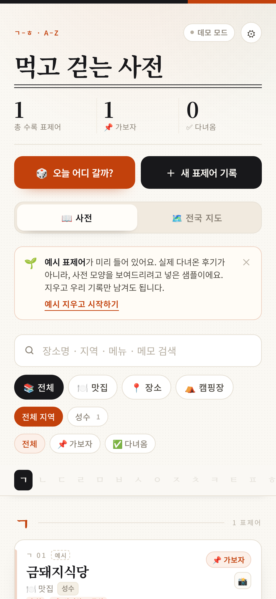

# 📖 먹고 걷는 사전

> “먹자”, “가보자”라고 말한 것들이 많아져서 — ㄱ부터 ㅎ, A부터 Z까지 차곡차곡 적어두는 사전.

둘이서 하나씩 채우는 **맛집 · 장소 · 캠핑장 사전**입니다. 빌드 없이 `index.html` 하나로 돌아가고,
Supabase를 연결하면 두 사람 폰이 **실시간으로 같은 사전**을 봅니다. 연결 전에도 이 브라우저에 저장되는
**데모 모드**로 바로 쓸 수 있어요.



---

## 무엇이 들어있나

| 파일 | 설명 |
| --- | --- |
| `index.html` | 사전 앱 전체 (HTML + CSS + JS, 외부 빌드 없음) |
| `supabase_schema.sql` | 표제어 테이블·권한·실시간 설정 SQL. SQL Editor에 통째로 붙여넣고 RUN |
| `README.md` | 이 문서 |

## 핵심 기능

**사전처럼 넘겨보기**
- 표제어를 **한글 초성(ㄱ~ㅎ) / 알파벳(A~Z) / #** 으로 자동 분류합니다.
  `까`는 `ㄱ`, `Aoyama`는 `A`, `2026 벚꽃`은 `#` 섹션으로 들어갑니다.
- 위쪽 인덱스에서 **데이터가 있는 글자만 진하게** 표시되고, 누르면 그 섹션으로 부드럽게 이동합니다.
- 섹션마다 큰 글자와 `ㄱ 01`, `ㄱ 02` 같은 표제어 번호가 붙어 사전 느낌을 냅니다.

**찾기**
- 검색창 하나로 **장소명 · 지역 · 추천 메뉴 · 방문월 · 메모 · 후기**를 한 번에 찾습니다.
- **초성 검색**도 됩니다. `ㄱㄷ`을 치면 `금돼지식당`이, `ㅅㅅ`을 치면 `서울숲`이 나옵니다.
- 카테고리 칩 `전체 / 🍽️ 맛집 / 📍 장소 / ⛺ 캠핑장` 세 가지와 상태 칩 `📌 가보자 / ✅ 다녀옴` 으로 좁혀볼 수 있습니다.
  (예전에 `카페`·`명소`·`바·술집`·`놀거리`로 저장된 표제어는 열면 자동으로 3가지 중 하나로 옮겨집니다.)
- **지역 칩**은 지금 사전에 적힌 지역을 자동으로 모아 보여줍니다. `전체 지역 / 성수 / 을지로 …`
  를 누르면 그 동네 표제어만 남습니다.
- **정렬**은 `ㄱ~ㅎ 순`(사전 순)과 `📍 지역별` 중에서 고릅니다. 지역별로 고르면 같은 동네 표제어가
  한 묶음으로 모이고, 인덱스 대신 지역 머리글이 붙습니다.

**기록하기**
- 표제어마다 **장소명 · 카테고리 · 지역/동네 · 추천 메뉴/볼거리 · 추천 방문월 · 관련 사이트 1~2개 · 메모 · 상태**를 담습니다.
- 관련 사이트는 인스타그램, 네이버지도, 유튜브, 블로그, 홈페이지 중에서 고르고 **새 창으로** 열립니다.
  주소만 넣으면 사이트 종류는 자동으로 추정합니다.
- `📌 가보자` ↔ `✅ 다녀옴` 토글. 다녀옴으로 바꿀 때 **별점과 한 줄 후기**를 남길 수 있고, 나중에 고쳐도 됩니다.

**🗺️ 전국 발자국 (지도)**
- 상단의 `📖 사전 | 🗺️ 전국 지도` 탭으로 **대한민국 전국 지도**를 열 수 있습니다.
  지도는 외부 API 없이 앱 안에 들어 있는 벡터(SVG)입니다. (Natural Earth public domain 시·도 경계를 다듬어 그림)
- 시·도 17개를 **10개 권역**으로 묶었습니다: 서울 / 경기·인천 / 강원 / 충북 / 충남·대전·세종 / 전북 / 전남·광주 / 경북·대구 / 경남·부산·울산 / 제주
- `✅ 다녀옴` 기록이 있는 지역은 **테라코타로 진하게** 칠해지고 다녀온 개수가 동그라미로 붙습니다.
  `📌 가보자`만 있는 지역은 **연한 톤 + 작은 점**, 아직 기록이 없는 지역은 종이색으로 남습니다.
- 지도나 아래 `지역 한눈에` 목록에서 지역을 누르면 **다녀옴 N · 가보자 M** 요약과 그 지역 표제어만 바로 모아 보여줍니다. 다시 누르면 해제됩니다.
- 지역 이름(`성수`, `강남`, `양양`, `가평`, `애월`, `해운대`, `전주` …)에서 **권역을 자동으로 찾습니다.**
  추가·수정 폼의 **지도 지역**에서 `자동 감지` 대신 직접 고를 수도 있고, 해외는 `지도 밖`으로 둘 수 있습니다.

**오늘 어디 갈까?**
- `🎲 오늘 어디 갈까?` 는 **가보자 표제어 중 하나를 뽑아** 사전을 넘기는 애니메이션과 함께 보여줍니다.
- 모달 위쪽에서 **지역을 고를 수 있습니다.** `전체 지역` 또는 가보자에 등록된 동네(예: `성수`)를 고르면
  그 지역 안에서만 뽑습니다. 고른 지역에 후보가 없으면 다른 지역을 고르거나 그 지역 표제어를 바로 추가할 수 있어요.
- 결과에서 바로 `자세히` 또는 관련 사이트로 이동할 수 있습니다.

**둘이 같이**
- ⚙ 설정에서 Supabase `Project URL` + `Anon key`를 넣으면 **실시간 연결**.
  한 사람이 적으면 다른 폰 목록에 바로 나타납니다.
- 연결하지 않아도 모든 기능이 동작하고, 데이터는 그 브라우저(localStorage)에만 저장됩니다.

**사전 이름 바꾸기**
- ⚙ 설정 → `사전 이름` 을 고치면 제목이 바뀌고 이 브라우저에 기억됩니다. (기본: `먹고 걷는 사전`)

---

## 1. 바로 써보기 (데모 모드)

1. `index.html` 을 브라우저로 엽니다. (파일을 그냥 더블클릭해도 됩니다.)
2. 처음 열면 **예시 표제어 1개(금돼지식당)** 가 들어 있습니다. 실제 다녀온 후기가 아니라 사전 모양을 보여주는 샘플이에요.
   - 예전 버전에서 예시 8개가 저장된 브라우저도, 열면 예시는 금돼지식당 하나로 정리되고 직접 적은 표제어는 그대로 남습니다.
   - 카드의 `예시` 표시와 상단 안내로 구분됩니다.
   - `예시 지우고 시작하기` 를 누르면 샘플만 지워지고, 내가 적은 기록은 남습니다.
3. `＋ 새 표제어 기록` 으로 첫 줄을 적어보세요. 이름만 있으면 저장됩니다.
4. 폰 브라우저에서 열고 **홈 화면에 추가**하면 앱처럼 쓸 수 있습니다.

> 데모 모드의 기록은 **그 브라우저에만** 저장됩니다. 브라우저 데이터를 지우면 사라지니,
> 둘이 같이 쓰려면 아래 Supabase 연결을 권합니다.

---

## 2. Supabase 실시간 연결

### 2-1. 프로젝트 만들기
1. <https://supabase.com> 로그인 → **New project**
2. 이름은 아무거나(예: `place-dict`), 리전은 **Northeast Asia (Seoul)** 추천
3. 생성 후 **Project Settings → API** 에서 두 값을 복사
   - `Project URL` — `https://xxxxxxxx.supabase.co`
   - `anon public` key — `eyJhbGciOi...`

> 무료 플랜으로 충분합니다. 한동안 안 쓰면 잠들 수 있는데, 페이지를 열면 깨어납니다.

### 2-2. SQL 실행
1. 왼쪽 메뉴 **SQL Editor → New query**
2. 이 폴더의 [`supabase_schema.sql`](./supabase_schema.sql) 내용을 통째로 붙여넣기
   - 앱 ⚙ 설정의 **📋 SQL 복사** 버튼을 눌러도 같은 내용이 복사됩니다.
3. **RUN** → `Success` 확인

이 한 번으로 표제어 테이블, RLS 권한, 실시간(Realtime) 설정, `updated_at` 자동 갱신이 모두 만들어집니다.
**이미 쓰던 프로젝트라면** 그대로 다시 RUN 하면 됩니다. 칼럼은 `add column if not exists` 로 안전하게 추가됩니다.

### 2-3. 앱에 연결
1. 앱 오른쪽 위 **⚙** → `Project URL` 과 `Anon public key` 붙여넣기
2. **연결 테스트** → `✅ 연결 성공` 확인
3. **저장하고 연결** → 상단 배지가 **실시간 연결**로 바뀝니다.

두 사람이 각자 폰에서 같은 페이지를 열고 각자 ⚙에 같은 값을 넣으면 끝입니다.

> `index.html` 맨 아래 스크립트의 `SUPABASE_URL`, `SUPABASE_ANON_KEY` 상수를 채워두는 방식도 있지만,
> 지금은 ⚙ 화면에서 넣는 값이 이 브라우저에 저장됩니다. (공개 페이지에는 anon key만 넣으세요.)

---

## 3. GitHub Pages 배포

```bash
# 이 폴더(place-dict-project)에서
git init
git add .
git commit -m "먹고 걷는 사전"
git branch -M main
git remote add origin https://github.com/<아이디>/<저장소>.git
git push -u origin main
```

그다음 GitHub 저장소 → **Settings → Pages** → Source: `Deploy from a branch`,
Branch: `main` / `/ (root)` → **Save**.

1~2분 뒤 `https://<아이디>.github.io/<저장소>/` 에서 열립니다.
폰에서 열고 **홈 화면에 추가**하면 사전 앱처럼 사용할 수 있어요.

> 저장소를 **비공개(private)** 로 두면 GitHub Pages가 무료 플랜에서는 열리지 않을 수 있습니다.
> 주소를 아는 사람만 보게 하려면 저장소는 공개하되 ⚙의 Supabase 값과 무관하게
> 6번 “더 조이고 싶을 때”를 참고하세요.

---

## 4. 데이터 구조

`public.place_entries` 한 테이블을 씁니다.

| 칼럼 | 의미 | 예 |
| --- | --- | --- |
| `name` | 표제어 (필수) | `금돼지식당` |
| `category` | 카테고리 (3가지) | `맛집` `장소` `캠핑장` |
| `region` | 지역·동네 | `성수`, `교토` |
| `zone` | 지도의 권역 (자동 감지 결과 또는 직접 선택, `밖` = 지도 밖) | `서울`, `제주`, `밖` |
| `recommend_menu` | 추천 메뉴·볼거리 | `🥩 삼겹살·목살` |
| `visit_month` | 추천 방문월·시기 | `🌸 4월 벚꽃` |
| `link1_label` / `link1_url` | 관련 사이트 1 | `인스타그램` / `https://...` |
| `link2_label` / `link2_url` | 관련 사이트 2 (선택) | `네이버지도` / `https://...` |
| `memo` | 메모 | `오픈 30분 전에 가서 이름 걸기` |
| `author` | 예전 버전 호환용 (앱에서 쓰지 않음, 비워 둠) | `''` |
| `status` | 상태 | `가보자`, `다녀옴` |
| `rating` | 별점 (다녀옴일 때) | `4.5` |
| `review` | 한 줄 후기 | `노을이 미쳤음` |
| `is_sample` | 예시 표제어 여부 | `true` / `false` |
| `created_at` / `updated_at` | 생성·수정 시각 | 자동 |

## 5. 문제 해결

| 증상 | 해결 |
| --- | --- |
| 배지가 **데모 모드** | ⚙에서 URL/Key를 넣고 **연결 테스트** → **저장하고 연결** |
| `relation ... does not exist` | 2-2의 SQL을 아직 실행하지 않았습니다. `supabase_schema.sql`을 RUN 하세요. |
| `column ... does not exist` | 예전 스키마입니다. `supabase_schema.sql`을 다시 RUN 하면 칼럼이 추가됩니다. (`zone` 포함) |
| `Invalid API key` | Anon key를 잘못 복사했습니다. Project Settings → API에서 다시 복사하세요. |
| 한쪽 폰만 안 바뀜 | 두 사람이 **같은 URL·같은 Anon key**를 넣었는지 확인. Realtime은 탭이 백그라운드면 잠시 늦을 수 있고, 다시 열면 즉시 맞춰집니다. |
| 사이트가 안 열림 | GitHub Pages 설정(브랜치/루트)을 확인하고 1~2분 기다리세요. |
| 폰에서 글자가 각져 보임 | Noto Serif KR 웹폰트를 불러오지 못한 경우입니다. 잠시 후 새로고침하거나 기본 글꼴로 표시됩니다. |

## 6. 보안 메모

- `anon` key는 페이지 소스에 그대로 들어가는 **공개 키**입니다. 주소를 아는 사람은 누구나 읽고 쓸 수 있으니 **둘만** 공유하세요.
- 더 조이고 싶다면 `supabase_schema.sql` 맨 아래 **6) 더 조이고 싶을 때** 주석을 참고해
  초대 코드(room code)나 Supabase Auth(이메일 매직링크)를 붙이면 됩니다.
- 이 저장소에는 이름·전화번호·계정 같은 개인정보를 넣지 않았습니다. 표제어에는 누가 적었는지도 저장하지 않습니다.
- 예시 표제어는 실제 방문 후기가 아니라 화면을 보여주기 위한 샘플입니다.
